<p align="center"></p>

<p align="center">
  <b>Explainable conflict checks for land deeds, before registration and before mutation.</b><br>
  LandTech Innovation Hackathon 2026 · Track: Digital Land Records, Verification &amp; Digitization · Problem <b>P3, Catch Fraud &amp; Double-Selling</b>
</p>

<p align="center">
  <a href="https://land-tech-innovation-hackathon-2026.vercel.app/"></a>
  
  
</p>

<p align="center"><a href="https://land-tech-innovation-hackathon-2026.vercel.app/">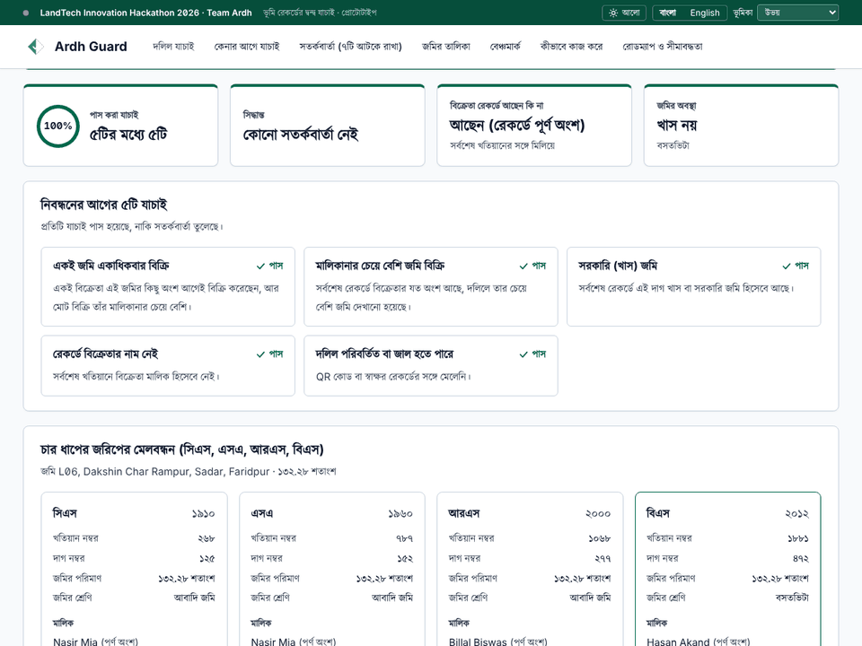</a></p>

<p align="center"><sub>Click the demo to try it live. Six one-click examples on the first screen.</sub></p>

---

## The problem

In Bangladesh, a deed, the khatian chain (CS, SA, RS, BS) and the mutation record are kept by different offices. Nobody cross-checks them before a sale or a mutation is accepted. Records, registration and management run through separate authorities [4], khatians carry known kinds of errors [2], and reform work calls for inter-checking between registering officers and AC (Land) offices before registration [3]. So the same land can be sold twice and sellers who do not own the land can slip through. More than 70 per cent of civil disputes arise from land-related conflicts, according to Ministry of Law figures reported in the press [10].

## What Ardh Guard does

A second pair of eyes at **two moments**: before a deed is registered, and before a mutation is approved. It compares the paperwork with the record chain and the seller's earlier deeds, then flags the case for a human officer **with plain-language reasons**. It never decides ownership.

<p align="center"></p>

### Two languages, two views

- **Bangla by default**, with an English toggle. The Bangla is written by context, not word for word: land-office terms follow how people say them (দলিল, খতিয়ান, নামজারি, দাগ, শতাংশ). See [`docs/GLOSSARY_BN.md`](docs/GLOSSARY_BN.md).
- **Citizen / buyer** view: a plain-language "check before you buy" page that never shows details of other people's deeds.
- **Officer / admin** view: deed checks, alerts and decisions, parcels, benchmark.
- **Both** shows every page together (the default for judges). The switch is a demo control, not a login.

The classic double sale, as Ardh Guard sees it:

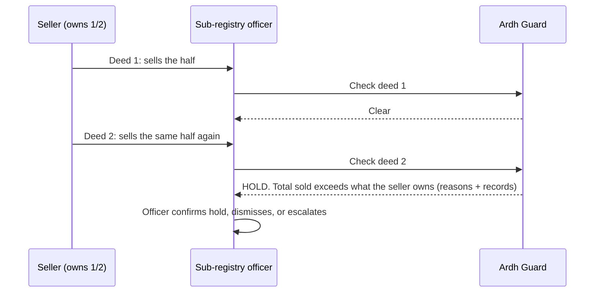

## See it

| | |
|---|---|
| **Check a deed (officer, Bangla)**<br>Enter a deed, get hold, review or clear with reasons.<br>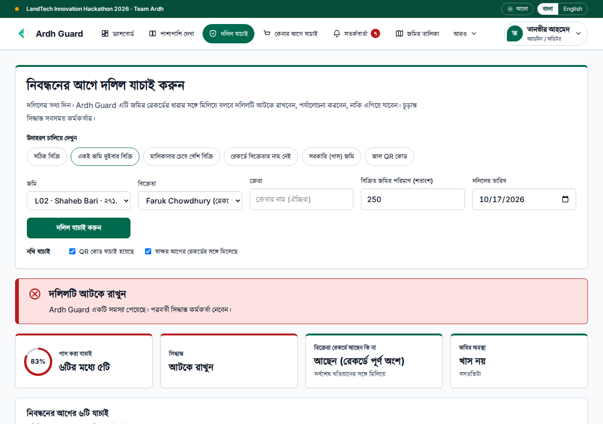 | **Check before you buy (citizen)**<br>Plain-language warning, record history and next steps.<br>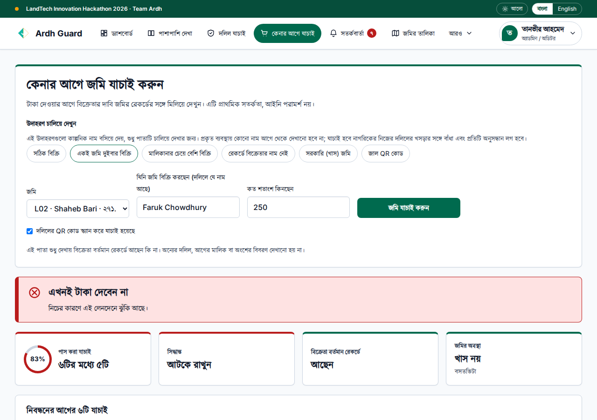 |
| **Same screen in English**<br>One tap on the language toggle.<br>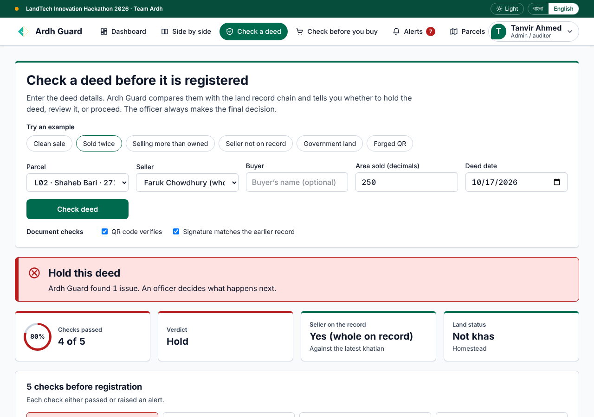 | **Alerts for officers**<br>Filter by checkpoint and severity, then decide.<br>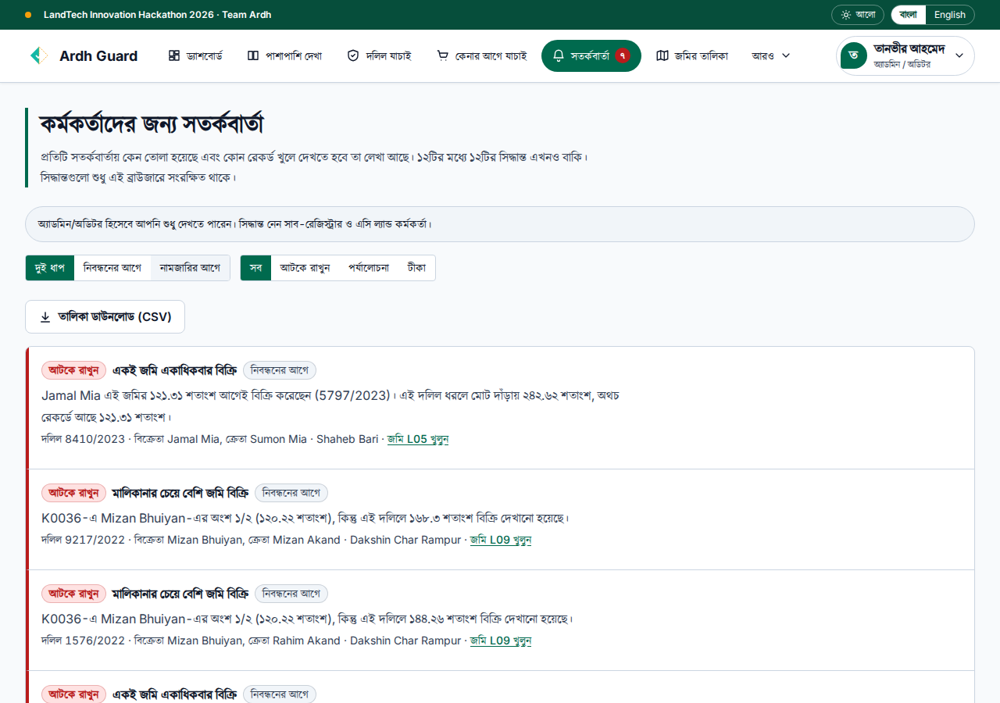 |
| **Parcels**<br>The CS, SA, RS, BS chain with deeds and mutations.<br>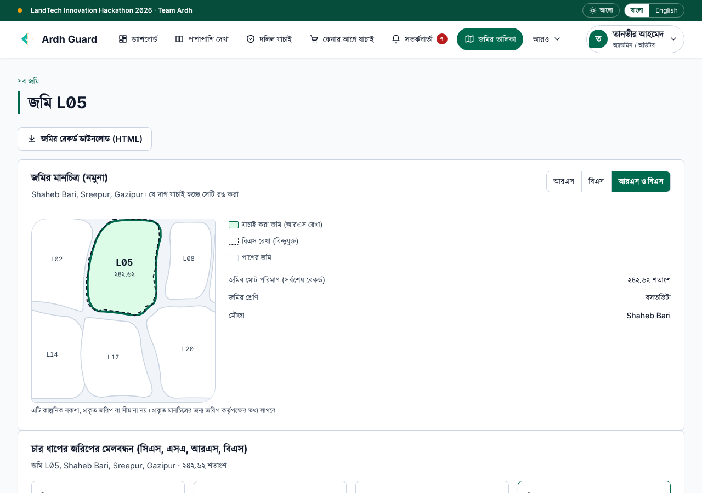 | **Benchmark**<br>Which planted anomalies the rules caught, with caveats.<br>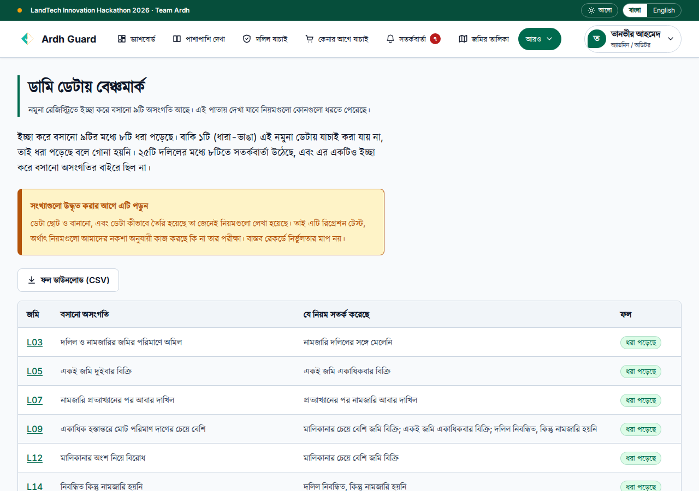 |
| **How it works**<br>The flow, the two checkpoints and all eight checks.<br>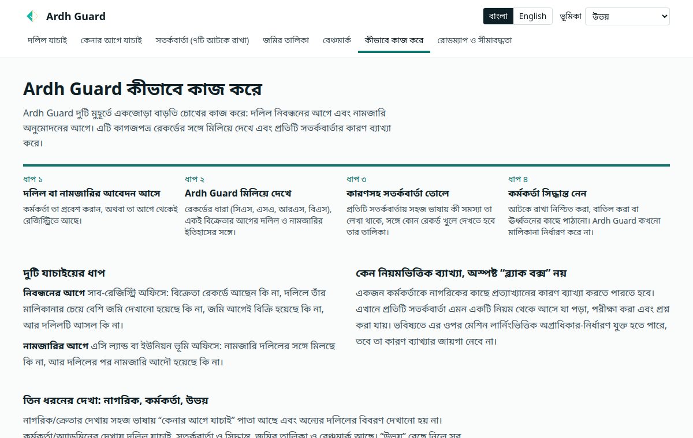 | **Roadmap and limits**<br>What is built, what is next, what it cannot do.<br>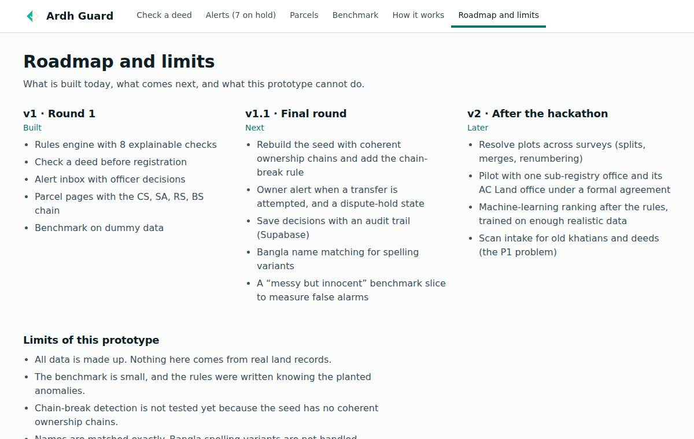 |

<p align="center">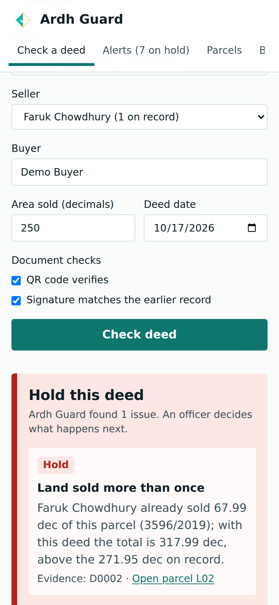<br><sub>Works on a phone too.</sub></p>

## The eight checks

| Check | Raised | Catches |
|---|---|---|
| Land sold more than once | Hold | Same seller's total sales exceed what they own (double sale) |
| Selling more than the seller owns | Hold | Deed claims more than the seller's recorded share |
| Government (khas) land | Hold | Latest record shows the plot as khas or government land |
| Seller is not on the record | Hold | Seller absent from the latest khatian |
| Document looks altered | Hold | QR code or signature does not match |
| Mutation does not match the deed | Review | Mutation changed a different area than the deed transfers |
| Deed never mutated | Review | Registered long ago, record still shows the old owner |
| Mutation resubmitted after rejection | Note | A workflow signal for human review |

## Benchmark (dummy data)

On the seed registry the rules caught **8 of 8 testable planted anomalies** and flagged **8 of 25 deeds**, none outside the planted cases. Run it yourself with `npm run eval`.

> **Read this before quoting the numbers.** The data is small and made up, and the rules were written knowing how it was generated. This is a regression test that the rules do what we designed, **not** a measure of accuracy on real records. Related prior art [6] stores land titles on a blockchain; Ardh Guard instead checks conflicts before a transaction is accepted. The ninth anomaly (a chain break between surveys) is not testable on this seed. See [`data/DATA_README.md`](data/DATA_README.md).

## How it is built

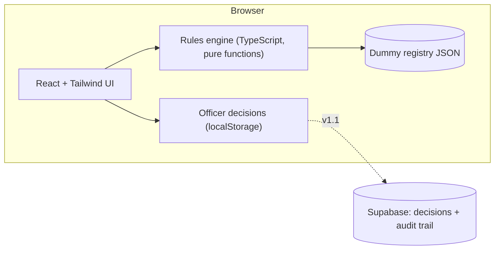

- **No backend needed.** The engine runs in the browser on the dummy data, so the demo works offline and on any phone.
- **Pure functions.** `analyze(registry)` takes records in and returns alerts out. It is easy to test (`npm test`) and easy to explain.
- **Hosted on Vercel** [16], deployed from this repository. Live: [19].

**Stack:** TypeScript · React [13] · Vite [14] · Tailwind CSS [15] · Vercel [16] (Supabase [17] planned for decisions and audit) · Kalpurush (Bangla) and Inter (Latin) fonts

## Where Ardh Guard fits in the land system

Ardh Guard is designed as a **read-only advisory layer beside the existing registration and mutation workflow**, not inside it. Each office keeps its own system. Ardh Guard reads what those systems already hold, runs the checks, and hands an authorized officer a result with reasons. The prototype in this repository runs on dummy data; the flow below is the target design for a pilot.

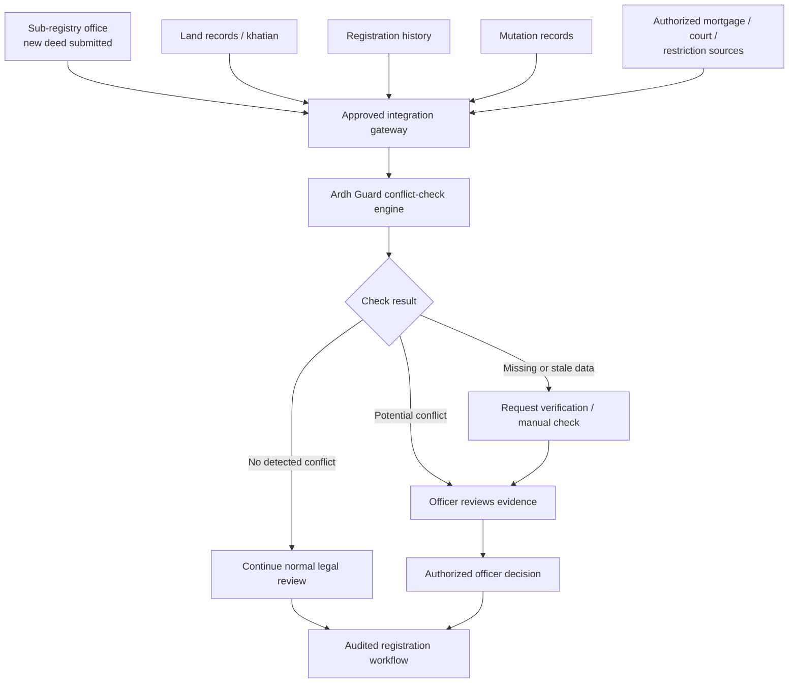

### What goes in

| Source | What Ardh Guard reads | In the prototype |
|---|---|---|
| Sub-registry office | The new deed: seller, buyer, area and share sold, QR and signature validity | Built (`Deed`) |
| Land records / khatian | The CS, SA, RS, BS chain, recorded owners and shares, land class (khas) | Built (`Khatian`, `Lineage`) |
| Registration history | The seller's earlier deeds on the same plot | Built (same `Deed` list) |
| Mutation records | Mutation case status and the area actually mutated | Built (`Mutation`) |
| Mortgage / court / restriction sources | Liens, court orders and restrictions on the plot | **Not built.** Planned for v2 |

Today the engine takes one `Registry` (those four record types) and returns a list of `Alert`s. A gateway only has to produce that same shape, so the engine does not change when real sources are connected.

### What comes out

| Check result | Prototype today | What happens next |
|---|---|---|
| **No detected conflict** | No hold or review alert | Normal legal review continues. This is not a title guarantee. |
| **Potential conflict** | Hold or review alerts, each with a plain reason and the records behind it | An officer reviews the evidence and holds, dismisses or escalates (saved only in the browser for now; saved with an audit trail in v1.1) |
| **Missing or stale data** | Partly: only the "deed never mutated" check looks at staleness | **Planned for v1.1.** A general outcome that requests verification or a manual check, then joins the officer review |

### Rules of integration

1. **Read-only.** Ardh Guard never writes to land records and cannot register, reject or mutate anything.
2. **Approved gateway only.** Data arrives only through connections agreed with the office that owns it, under a formal agreement. Each source can be switched off on its own.
3. **A person decides.** The only route to a decision is an authorized officer, and every decision is logged. A draft schema for flags and an audit log is in [`supabase/migrations`](supabase/migrations).
4. **Every path is audited.** A "no conflict" result is recorded in the workflow too, not only the holds.
5. **Missing data never reads as clear.** If a source is absent or out of date, the case goes to manual verification rather than passing silently.
6. **Citizens see only their own check.** The "check before you buy" page never shows other people's deeds (already built and tested).

### Suggested rollout

| Stage | What changes | Status |
|---|---|---|
| 0. Prototype | Dummy data, rules engine, officer and citizen views | Built |
| 1. Shadow mode | Runs next to one sub-registry and AC Land office on real records; alerts are shown but the workflow is unchanged. We measure false alarms and misses. | Proposed |
| 2. Advisory in the workflow | Hold and review results appear at the pre-registration and pre-mutation checkpoints, with saved decisions and sign-in | Proposed (v1.1 to v2) |
| 3. More sources and offices | Mortgage, court-case and land-tax sources; more sub-registries | Proposed (v2) |

## Run it locally

```bash
git clone <this repo>
cd <repo>
npm install
npm run dev        # web app on http://localhost:5173
npm run build      # typecheck + production build
npm run eval       # benchmark in the terminal (Node 22.18 or newer)
npm test           # engine checks (6 live scenarios, 6 planted anomalies) + language checks (every string in Bangla and English, no unresolved placeholders, citizen text leaks nothing)
```

<details>
<summary>Repository map</summary>

```
src/engine/      rules, types, benchmark evaluation (no dependencies)
src/pages/       Check (officer), Buy (citizen), Inbox (alerts), Cases (parcels), Benchmark, HowItWorks, About
src/components/  chain strip and UI pieces
src/lib/         dummy data access, strings.ts (Bangla + English), language and role providers, officer decisions
data/            dummy registry (JSON/CSV), generator script, labelled anomalies, notes
docs/            plan, research notes, source triage, concept note outline, media
scripts/         evaluate.ts, test-rules.ts, make-media.py (README screenshots)
supabase/archive/ earlier prototype schema, kept for v1.1 (audit chain)
```
</details>

## Data used

**Dummy data only**, as the rule book requires [1]. A fictional registry (3 mouzas, 24 parcels, 96 khatians, 25 deeds, 23 mutation cases, 9 labelled anomalies) generated by [`data/gen_seed.py`](data/gen_seed.py). No real people, NID numbers, phone numbers or land records, and nothing is scraped from government websites. No external dataset is used; if a public, non-personal source is added later it will be credited here.

## AI tools used

- **Claude (Anthropic) [12]:** project planning, drafting the rules engine, UI code and documentation, and the visual refresh (theme, dark mode, mobile layout) that follows the mockups in [`design/potential-designs/`](design/potential-designs). The team reviewed everything and can explain every file.
- **Consensus.app [11]:** literature search reports, summarised in [`docs/SOURCES.md`](docs/SOURCES.md).
- No AI model runs inside the app and none was trained. Planned AI features are listed in the roadmap above.

## Roadmap

| | Scope | Status |
|---|---|---|
| **v1 (Round 1)** | Rules engine (8 checks) · check a deed · alerts with officer decisions · parcel pages · citizen "check before you buy" page · benchmark · Bangla (default) and English · citizen / officer / both views · in-app docs | Built |
| **v1.1 (final round)** | Coherent-chain seed and chain-break rule · owner alert and dispute hold · saved decisions with audit trail (Supabase) · a "missing or stale data" outcome that asks for manual verification instead of reading as clear · sign-in and role-based access · Bangla name matching · **AI: plain-language case summaries in Bangla and English** (pretrained model, officer reviews) · a "messy but innocent" benchmark slice | Next |
| **v2** | Plot lineage across surveys · pilot with one sub-registry and AC Land office under a formal agreement · **AI: Bangla OCR for scanned khatians and deeds** (pretrained, officer confirms, the P1 problem) · **AI: ML risk ranking after the rules** once there is enough realistic data (rules and reasons stay) · mortgage, court-case and land-tax checks for citizens | Later |

> All AI items are **plans**. There is no AI model in the app today. Where a model is needed we will use pretrained models (for example from Hugging Face [18]) and list them here.

**Changes since Round 1:**

- New visual design from the mockups in [`design/potential-designs/`](design/potential-designs): forest-green civic palette, two-tier header, card layout, tinted status banners, light and dark themes (the choice is remembered), and a bottom tab bar on phones.
- Bangla now uses the Kalpurush typeface (self-hosted, SIL OFL 1.0); Latin text and numerals use Inter.
- New README section on [where Ardh Guard fits in the land system](#where-ardh-guard-fits-in-the-land-system), with the target integration flow.
- MIT licence added.
- No change to the rules engine, the data or the results.

## Limitations

- All data is made up. A real pilot needs an agreement with the land authorities.
- The benchmark is small and the rules were written knowing the planted anomalies.
- Chain-break detection is untested: the seed has no coherent ownership chains.
- Names are matched exactly; Bangla spelling variants are not handled, and the dummy names are in Latin script.
- Each parcel arrives with a lineage id. Linking plots across surveys is the hard part in reality.
- The citizen / officer / both switch is a demo control, not sign-in or access control.
- The citizen page does not check mortgages, court cases or land tax.
- Ardh Guard flags cases for officers. It does not decide ownership and is not a legal title check.

**Concept note (3 pages, Bangla and English):** [`docs/concept-note/`](docs/concept-note). **Pitch deck [20]:** interactive and bilingual at [`/deck/`](https://land-tech-innovation-hackathon-2026.vercel.app/deck/) (arrow keys, `N` notes, `O` overview, `L` language, `F` fullscreen); PDFs in [`docs/deck/`](docs/deck).

More in [`docs/`](docs): [plan](docs/PLAN.md) · [research notes](docs/RESEARCH_NOTES.md) · [sources](docs/SOURCES.md) · [concept note outline](docs/CONCEPT_NOTE_OUTLINE.md)

## Team Ardh

| | |
|---|---|
| **Jobayer** (Team Leader) | [@MJZ-Hossen](https://github.com/MJZ-Hossen) |
| **S.M. Mehedy Kawser** | [@mehedyk](https://github.com/mehedyk) |
| Faculty mentor | Zannatul Mawa Koli |
| Industry mentor | MD. Tahamid Hassan Sadib (CSE-TECH) |

Built for the LandTech Innovation Hackathon 2026 [1], organized by the Department of CSE and CSE-TECH, Daffodil International University, with support from the Department of Law.

## License

Code and documentation: [MIT](LICENSE). The Kalpurush font in `public/fonts/` keeps its own licence, the SIL Open Font License 1.0, see [`public/fonts/README.md`](public/fonts/README.md).

<!-- refs:start -->
## References

[1] LandTech Innovation Hackathon 2026 Rule Book, version 1.2. Department of CSE and CSE-TECH, Daffodil International University. [LandTech Innovation Hackathon 2026 Rule Book (v1.2)](https://landtech.diu.edu.bd/landtech)  
[2] Raziv, M. M. H., Jalil, M. A., Mia, M. T. and Mahmud, F. U. (2024). Journal of Asian and African Social Science and Humanities, 10(2), 31-44. [Errors in the Land Record of Rights (Khatiyan) and the Remedial Procedure in Bangladesh: An Analysis of Existing Regulatory Framework and Future Reforms](https://doi.org/10.55327/jaash.v10i2.335)  
[3] Ayatullah, M. (2024). Feni University Journal, 3(1), 211-222. [Essentiality of Reforms of the Registration Act 1908: E-Registration Perspective](https://doi.org/10.3329/fuj.v3i1.86557)  
[4] Emam, J. (2022). Bangladesh Journal of Public Administration, 30(2), 47-62. [The Prospect of Integrated Land Administration and Management System (ILAMS) for Improving Land Related Service Delivery in Bangladesh](https://doi.org/10.36609/bjpa.v30i2.360)  
[6] Alam, K. M., Rahman, J. M. A., Tasnim, A. and Akther, A. (2022). Journal of King Saud University - Computer and Information Sciences, 34, 3096-3110. [A Blockchain-based Land Title Management System for Bangladesh](https://doi.org/10.1016/j.jksuci.2020.10.011)  
[10] Ahana, S. I. (2025, 23 November). The Daily Observer. [Digitising land records seen as a paradigm shift](https://observerbd.com/news/555055)  
[11] Consensus (2026). AI-generated literature search reports used for scoping (P3 gap analysis; CS, SA, RS, BS chain; e-services). [Consensus: AI research assistant](https://consensus.app)  
[12] Anthropic. Claude, used for planning and for drafting code and documents. [Claude (Anthropic)](https://www.anthropic.com/claude)  
[13] React: the library for web and native user interfaces. [React](https://react.dev)  
[14] Vite: next generation frontend tooling. [Vite](https://vite.dev)  
[15] Tailwind CSS: a utility-first CSS framework. [Tailwind CSS](https://tailwindcss.com)  
[16] Vercel: hosting platform for the live prototype. [Vercel](https://vercel.com)  
[17] Supabase: Postgres development platform (planned for saving decisions and the audit trail). [Supabase](https://supabase.com)  
[18] Hugging Face: platform for pretrained models (planned source for roadmap AI features). [Hugging Face](https://huggingface.co)  
[19] Team Ardh (2026). Ardh Guard live prototype. [Ardh Guard: live prototype](https://land-tech-innovation-hackathon-2026.vercel.app/)  
[20] Team Ardh (2026). Ardh Guard pitch deck, interactive and bilingual. [Ardh Guard: pitch deck](https://land-tech-innovation-hackathon-2026.vercel.app/deck/)  

### Other project references

- [5] [Citizens' Perspective on Land E-Mutation at Upazila Land Offices in Mymensingh](https://doi.org/10.34104/ajssls.023.02910305)
- [7] [Digitizing Land Governance in Bangladesh: A Qualitative Study of Urban and Rural Citizens' Experiences with the Digital Land Record Management System](https://doi.org/10.36481/jsp.v01.i01.3vmg5j09)
- [8] [The Impact of E-services on People's Empowerment: An Investigation into E-mutation Service of Bangladesh](https://doi.org/10.53808/KUS.2024.21.02.1177-ss)
- [9] [Digitalization of the Land Record System in Bangladesh: Prospects and Challenges](https://ssrn.com/abstract=5012153)

Numbers are the same in every file. Full list with notes on what we read: [`docs/REFERENCES.md`](docs/REFERENCES.md).
<!-- refs:end -->
