<p align="center"></p>

<p align="center">
  <b>Explainable conflict checks for land deeds, before registration and before mutation.</b><br>
  LandTech Innovation Hackathon 2026 · Track: Digital Land Records, Verification &amp; Digitization · Problem <b>P3, Catch Fraud &amp; Double-Selling</b>
</p>

<p align="center">
  <a href="https://land-tech-innovation-hackathon-2026.vercel.app/"></a>
  
  
</p>

<p align="center"><a href="https://land-tech-innovation-hackathon-2026.vercel.app/"></a></p>

<p align="center"><sub>Click the demo to try it live. Six one-click examples on the first screen.</sub></p>

---

## The problem

In Bangladesh, a deed, the khatian chain (CS, SA, RS, BS) and the mutation record are kept by different offices. Nobody cross-checks them before a sale or a mutation is accepted. Records, registration and management run through separate authorities [4], khatians carry known kinds of errors [2], and reform work calls for inter-checking between registering officers and AC (Land) offices before registration [3]. So the same land can be sold twice and sellers who do not own the land can slip through. More than 70 per cent of civil disputes arise from land-related conflicts, according to Ministry of Law figures reported in the press [10].

## What Ardh Guard does

A second pair of eyes at **two moments**: before a deed is registered, and before a mutation is approved. It compares the paperwork with the record chain and the seller's earlier deeds, then flags the case for a human officer **with plain-language reasons**. It never decides ownership.

<p align="center"></p>

### Downloads and the audit view

Every check opens as a full audit view: a verdict banner, four summary tiles (checks passed with a progress ring, verdict, seller on the record, land status), one card per check marked pass or flagged with its reason, the four-survey record chain with khatian, plot, area, land class and owners, the parties and transfer details, and a report panel.

| Where | What you can download | Format |
|---|---|---|
| Check a deed (officer) | The full audit report; the same data for other tools; print or save as PDF | HTML · JSON · print dialog |
| Check before you buy (citizen) | A buyer's report with only your own inputs and the short reasons. It never contains other owners, deeds or evidence ids | HTML · print dialog |
| Alerts | The filtered list with each decision | CSV |
| Benchmark | The per-anomaly results | CSV |
| A parcel | The record chain with its deeds, mutations and alerts | HTML |

Reports follow the language you are using (Bangla or English). Each has a report ID, a short reference for that one check; it is **not** an official certificate. Everything is built in the browser, so nothing is uploaded. CSV files open correctly in Excel, including Bangla.

### Map and the locked NID box

- **Parcel map.** Every check, every parcel page and the citizen page show the plot on a sketch of its mouza, with **RS**, **BS** or both outlines (BS dashed) so you can see how two surveys can disagree. Officers see neighbouring parcel ids and can open them; citizens see only their own plot.
- **In the reports.** The HTML, print and JSON reports include the parcel map (RS shaded, BS dashed). The officer report also shows neighbouring parcel ids; the citizen report shows only the buyer's own plot, with no neighbour ids. Tests cover this.
- **NID (locked).** A collapsible box with a lock sign says that we would add NID matching here too, but the hackathon rules forbid NID and similar personal data, so the box is a disabled placeholder. What a real pilot would need first is in [`docs/INTEGRATION.md`](docs/INTEGRATION.md#7-legal-privacy-and-security).
- **No biometrics.** An earlier build had a simulated fingerprint step. It was removed before the final round: it contradicted our own rule of no biometrics, and a fake biometric button invites the wrong question. There is no fingerprint, photo or other biometric step anywhere in the app, and none is planned.
- **Data behind it.** [`data/parcel_geometry.json`](data/parcel_geometry.json) (made-up, irregular plot outlines per mouza, from an area-weighted Voronoi layout), from [`data/gen_geometry.py`](data/gen_geometry.py). It adds no records and changes no rule result.

### Sign-in, roles and dashboards

Open `#/login`. Four demo accounts are listed on the page (press a card to fill the form). This is a **front-end demo gate, not real authentication**; the sign-up page is written out but does nothing.

| Role | Email | Password | Sees |
|---|---|---|---|
| Citizen / buyer | `buyer@ardh.demo` | `Buyer@2026` | Dashboard, check before you buy |
| Sub-registrar | `registrar@ardh.demo` | `Regis@2026` | Dashboard, check a deed, alerts **before registration** (can decide), parcels |
| AC Land officer | `acland@ardh.demo` | `Land@2026` | Dashboard, alerts **before mutation** (can decide), parcels |
| Admin / auditor | `auditor@ardh.demo` | `Audit@2026` | Everything, **read-only**, including the side-by-side view and the benchmark |

The split follows the process: the sub-registrar registers a deed after checking the record of rights, then the AC (Land) office completes the mutation, so each office sees the alerts for its own moment. Each role opens on its own dashboard (numbers are computed from the registry and the rules; nothing is invented). The header has a navigation bar on wide screens and a hamburger drawer on small ones.

### Two languages

- **Bangla by default**, with an English toggle. The Bangla is written by context, not word for word: land-office terms follow how people say them (দলিল, খতিয়ান, নামজারি, দাগ, শতাংশ). See [`docs/GLOSSARY_BN.md`](docs/GLOSSARY_BN.md).
- The **citizen** view never shows details of other people's deeds. The **side-by-side screen** (admin only) shows the officer view in a green frame and the citizen view in a blue frame, both following the same parcel.

The classic double sale, as Ardh Guard sees it:

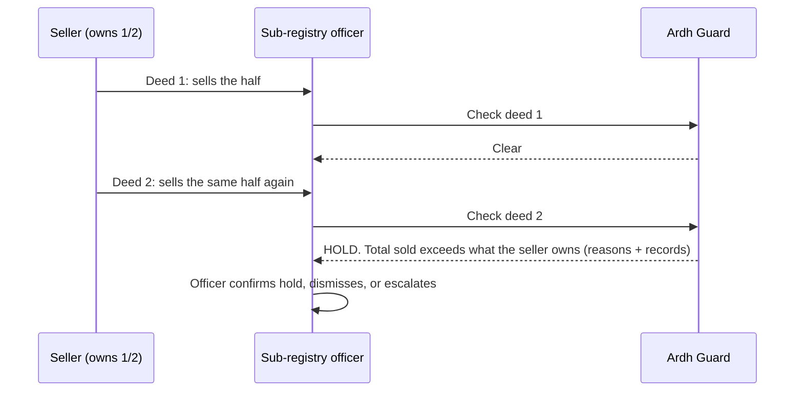

## See it

| | |
|---|---|
| **Check a deed (officer, Bangla)**<br>Enter a deed, get hold, review or clear with reasons.<br> | **Check before you buy (citizen)**<br>Plain-language warning, record history and next steps.<br> |
| **Admin side-by-side view**<br>Two framed views on one screen (admin/auditor only).<br>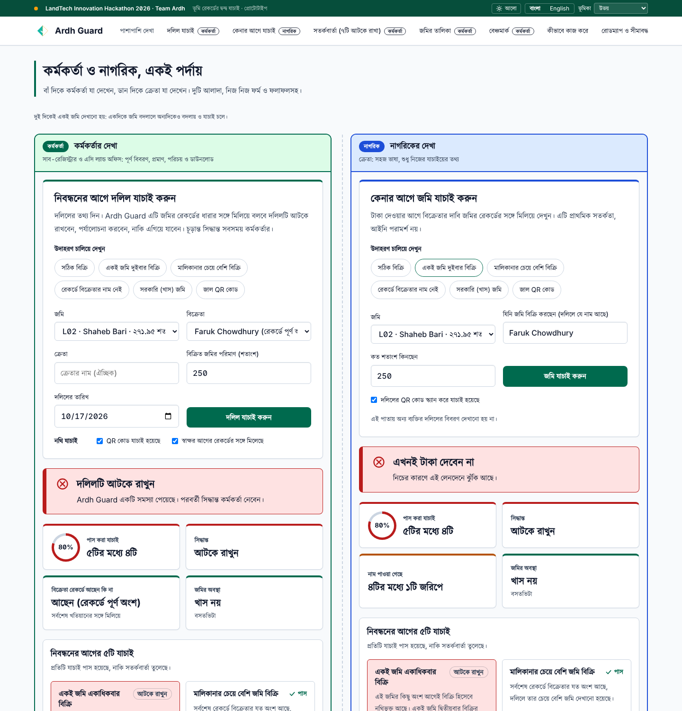 | **Full audit view**<br>Summary tiles, checks grid, record chain, parties and report panel.<br>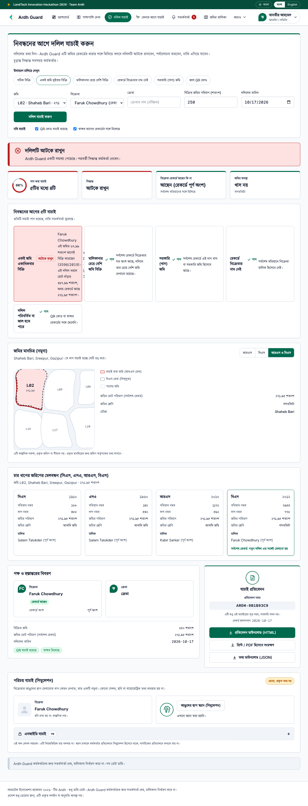 |
| **Parcel map**<br>RS and BS outlines on a small, made-up sketch with irregular plots.<br>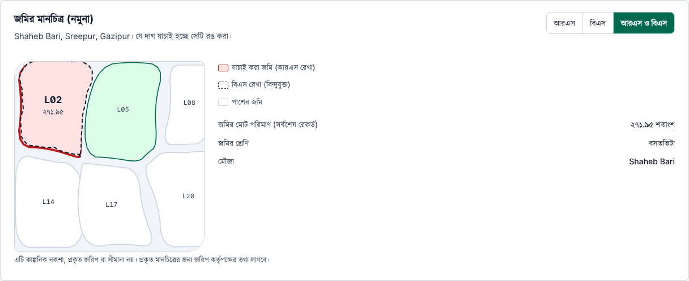 | **Locked NID box**<br>A disabled placeholder that explains why NID is off.<br>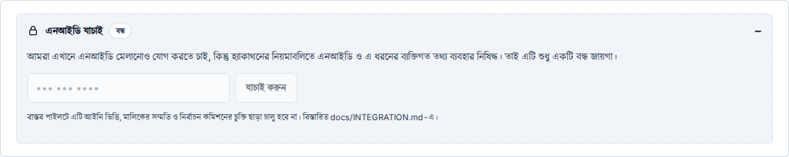 |
| **Downloadable report**<br>The HTML report saved from the audit view (also JSON and print to PDF).<br>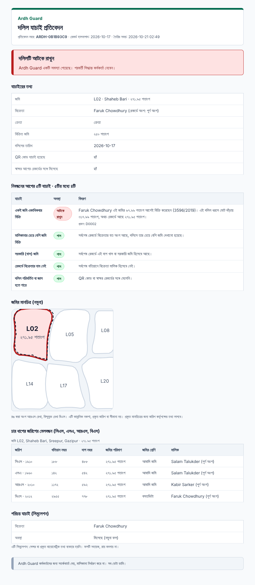 | **Dark theme**<br>The choice is remembered.<br>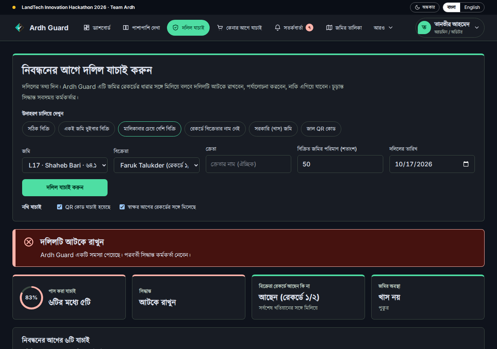 |
| **Same screen in English**<br>One tap on the language toggle.<br> | **Alerts for officers**<br>Filter by checkpoint and severity, then decide; export as CSV.<br> |
| **Parcels**<br>The map and the CS, SA, RS, BS chain with deeds and mutations.<br> | **Benchmark**<br>Which planted anomalies the rules caught, with caveats.<br> |
| **Dashboard (admin/auditor)**<br>Each role has its own; numbers come from the registry and rules.<br>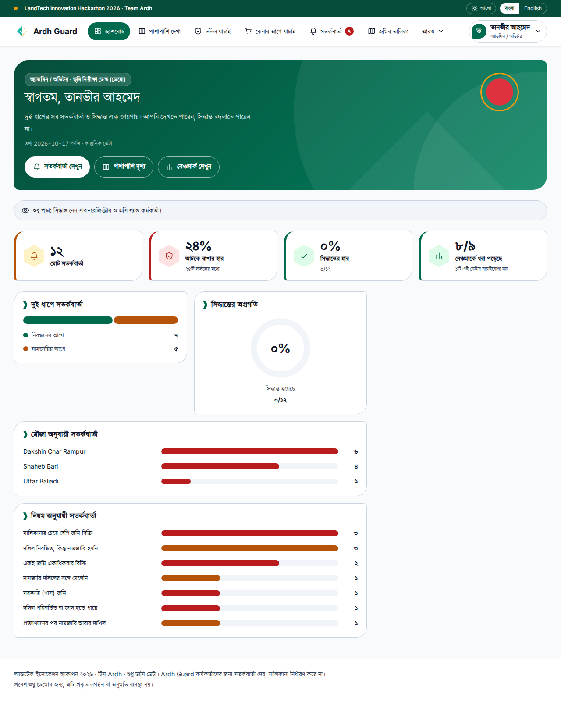 | **Sign-in**<br>Four demo accounts, one per role; sign-up is shown but not active.<br>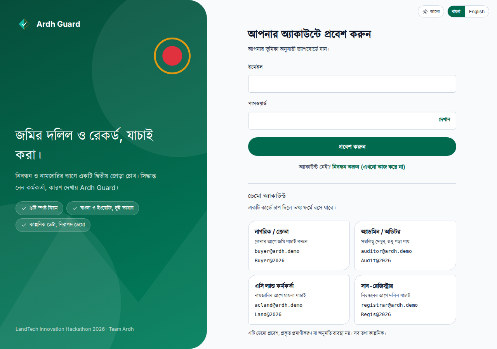 |
| **How it works**<br>The flow, the two checkpoints and all nine checks.<br> | **Roadmap and limits**<br>What is built, what is next, what it cannot do.<br> |

<p align="center"> 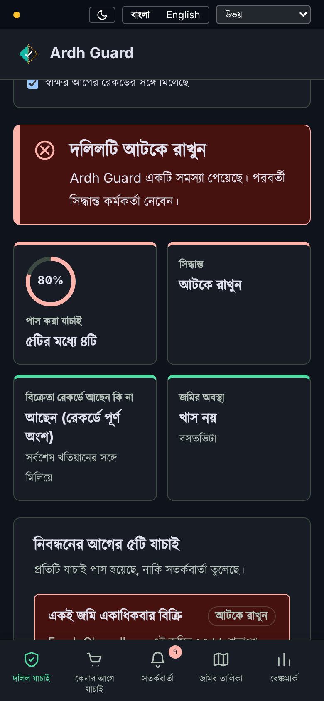<br><sub>Works on a phone too, with a hamburger menu and a dark theme.</sub></p>

> The screenshots are generated by `scripts/make-media.py` against the running app. Regenerate them after any visual change (see *Run it locally*).

## The nine checks

| Check | Raised | Catches |
|---|---|---|
| Input could not be verified | Review | The deed's plot is not in the record, the area is not a positive number, the date is missing or invalid or after the check date, or the deed number is already used. Runs first. Unreadable input is **never shown as clear**; it goes to an officer as "not verified". |
| Land sold more than once | Hold | Same seller's total sales exceed what they own (double sale). A deed whose mutation was rejected **still counts as sold**: registration and mutation are separate steps, so a rejected mutation does not cancel a registered deed. The alert names such deeds. |
| Selling more than the seller owns | Hold | Deed claims more than the seller's recorded share |
| Government (khas) land | Hold | Latest record shows the plot as khas or government land |
| Seller is not on the record | Hold, or Review for a resale before mutation | Seller absent from the latest khatian. If the seller bought this parcel from a recorded owner and that mutation is still open (no case yet, or only pending), and they resell no more than they bought, it is a Review. One hop only; longer chains, a rejected purchase or a stranger are held. |
| Document looks altered | Hold | QR code or signature does not match |
| Mutation does not match the deed | Review | Mutation changed a different area than the deed transfers |
| Deed never mutated | Review | Registered long ago, record still shows the old owner |
| Mutation resubmitted after rejection | Note | A workflow signal for human review |

The tolerances (0.5% on area, 2% on mutation, 180 days for a stale deed) are our assumptions, not land-office rules.

## Benchmark (dummy data)

The seed registry has **9 planted anomalies**. The rules caught **8 of the 9**. The ninth, a chain break between surveys, **cannot be tested on this seed**, so it is counted as not covered, not as a pass. The rules flagged **8 of 25 deeds**, none outside the planted cases. Run it yourself with `npm run eval`.

> **Read this before quoting the numbers.** The data is small and made up, and the rules were written knowing how it was generated. This is a regression test that the rules do what we designed, **not** a measure of accuracy on real records. Related prior art [6] stores land titles on a blockchain; Ardh Guard instead checks conflicts before a transaction is accepted. See [`data/DATA_README.md`](data/DATA_README.md) for why the chain break is excluded.
>
> Because the benchmark cannot show false alarms on honest-but-messy deeds, `npm test` also runs a few "messy but innocent" cases built on the seed: a resale before mutation, two small honest sales, and a rejected mutation. They are tests, not a measured false-alarm rate.

## How it is built

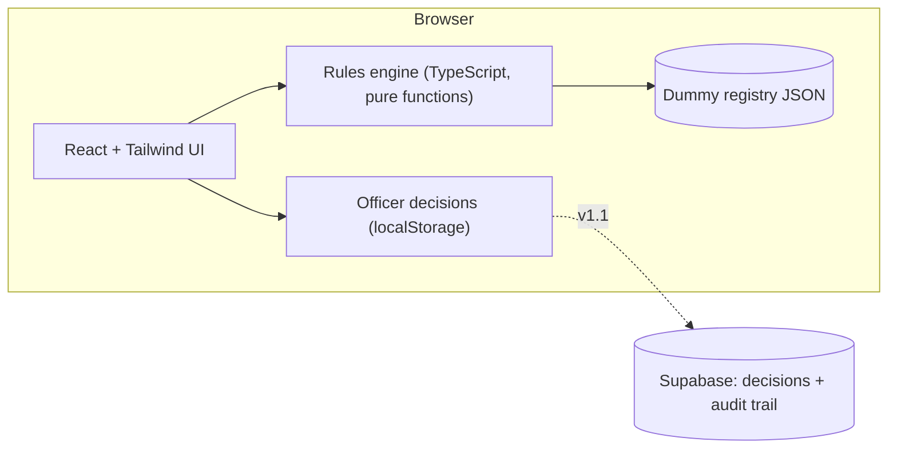

- **No backend needed.** The engine runs in the browser on the dummy data, so the demo works offline and on any phone.
- **Pure functions.** `analyze(registry)` takes records in and returns alerts out. It is easy to test (`npm test`) and easy to explain.
- **Hosted on Vercel** [16], deployed from this repository. Live: [19].

**Stack:** TypeScript · React [13] · Vite [14] · Tailwind CSS [15] · Vercel [16] (Supabase [17] planned for decisions and audit) · Kalpurush (Bangla) and Inter (Latin) fonts, both self-hosted

## Security

We audited the app ourselves and fixed what we found. The full report, with the tests we ran and what we could not test, is in **[`docs/SECURITY_AUDIT.md`](docs/SECURITY_AUDIT.md)**. Each choice follows published guidance rather than our own intuition:

| What we did | Why (source) |
|---|---|
| Content Security Policy with `object-src 'none'`, `base-uri 'none'`, `frame-ancestors 'none'`, and no third-party requests | OWASP CSP guidance [24]; clickjacking defence [26] |
| `nosniff`, `Referrer-Policy`, `Permissions-Policy`, COOP and HSTS headers (no HSTS preload, on purpose) | OWASP HTTP headers guidance [25] |
| Inter font self-hosted instead of Google Fonts | Lets the CSP stay strict and stops sending visitors' IPs to a third party [24] |
| Spreadsheet formula characters neutralised in CSV exports | CWE-1236 [29]; OWASP CSV injection [28] (the fix lowers risk but cannot guarantee it in Excel) |
| Report HTML escapes `'` too, carries its own CSP, and has a permanent hostile-input test | OWASP XSS prevention rules [27] |
| `service_role` key never in a `VITE_` variable; RLS, `revoke ... from public` and per-role policies planned before real data | Vite [32], Supabase [30], PostgreSQL [31] |
| CI with `npm audit`, secret scanning and Dependabot | Bundled code can hide vulnerable packages [33]; secrets can sit in compiled bundles [35] |

What is still open: the sign-in is a demo gate (not real authentication), and decisions are not yet stored server-side with who and when. Both are in the roadmap and the report. Three of the cited papers [33][34][35] we know only through the Consensus summary [11] and publication records, not the full text; [`docs/REFERENCES.md`](docs/REFERENCES.md) says exactly what we opened and what we did not.

## Where Ardh Guard fits in the land system

Ardh Guard is designed as a **read-only advisory layer beside the existing registration and mutation workflow**, not inside it. Each office keeps its own system. Ardh Guard reads what those systems already hold, runs the checks, and hands an authorized officer a result with reasons. The prototype in this repository runs on dummy data; the flow below is the target design for a pilot.

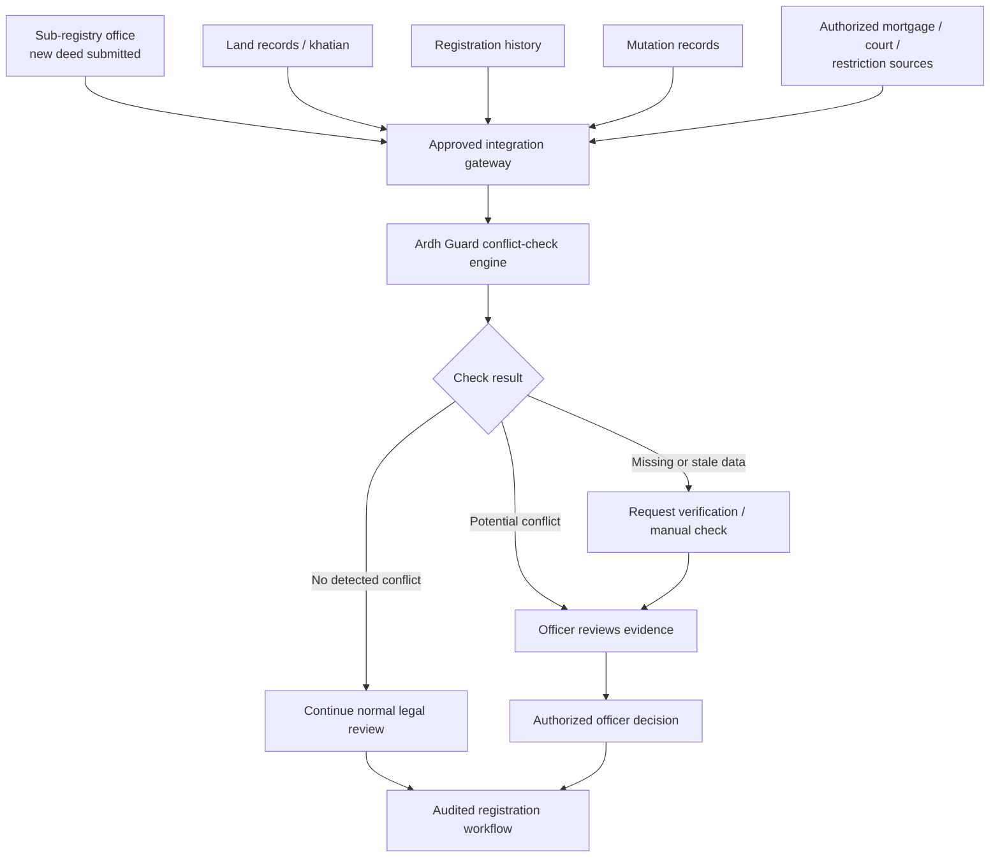

### What goes in

| Source | What Ardh Guard reads | In the prototype |
|---|---|---|
| Sub-registry office | The new deed: seller, buyer, area and share sold, QR and signature validity | Built (`Deed`) |
| Land records / khatian | The CS, SA, RS, BS chain, recorded owners and shares, land class (khas) | Built (`Khatian`, `Lineage`) |
| Registration history | The seller's earlier deeds on the same plot | Built (same `Deed` list) |
| Mutation records | Mutation case status and the area actually mutated | Built (`Mutation`) |
| Mortgage / court / restriction sources | Liens, court orders and restrictions on the plot | **Not built.** Planned for v2 |

Today the engine takes one `Registry` (those four record types) and returns a list of `Alert`s. A gateway only has to produce that same shape, so the engine does not change when real sources are connected.

### What comes out

| Check result | Prototype today | What happens next |
|---|---|---|
| **No detected conflict** | No hold or review alert | Normal legal review continues. This is not a title guarantee. |
| **Potential conflict** | Hold or review alerts, each with a plain reason and the records behind it | An officer reviews the evidence and holds, dismisses or escalates (saved only in the browser for now; saved with an audit trail in v1.1) |
| **Missing or stale data** | Partly. The input check sends a deed it cannot read (unknown plot, bad area or date, duplicate deed number) to an officer as "not verified", never as clear. The "deed never mutated" check looks at one kind of staleness. Out-of-date source records are **not** checked yet | **Planned for v1.1.** The stale-record half, with per-source freshness, then joins the officer review |

The full plan (three connection modes, a draft API contract, candidate data sources, gateway requirements, legal and security notes, exit criteria per stage, and what each mockup feature needs) is in **[`docs/INTEGRATION.md`](docs/INTEGRATION.md)**. The short version:

### Rules of integration

1. **Read-only.** Ardh Guard never writes to land records and cannot register, reject or mutate anything.
2. **Approved gateway only.** Data arrives only through connections agreed with the office that owns it, under a formal agreement. Each source can be switched off on its own.
3. **A person decides.** The only route to a decision is an authorized officer, and every decision is logged. A draft schema for flags and an audit log is in [`supabase/migrations`](supabase/migrations).
4. **Every path is audited.** A "no conflict" result is recorded in the workflow too, not only the holds.
5. **Missing data never reads as clear.** If a source is absent or out of date, the case goes to manual verification rather than passing silently.
6. **Citizens see only their own check.** The "check before you buy" page never shows other people's deeds (already built and tested).

### Suggested rollout

| Stage | What changes | Status |
|---|---|---|
| 0. Prototype | Dummy data, rules engine, role dashboards, demo sign-in for four roles, officer and citizen views | Built |
| 1. Shadow mode | Runs next to one sub-registry and AC Land office on real records; alerts are shown but the workflow is unchanged. We measure false alarms and misses. | Proposed |
| 2. Advisory in the workflow | Hold and review results appear at the pre-registration and pre-mutation checkpoints, with saved decisions and real sign-in (the demo sign-in is front-end only) | Proposed (v1.1 to v2) |
| 3. More sources and offices | Mortgage, court-case, vested-property and land-tax sources; more sub-registries | Proposed (v2) |

Exit criteria for each stage are in [`docs/INTEGRATION.md`](docs/INTEGRATION.md#9-rollout-and-exit-criteria).

## Run it locally

```bash
git clone <this repo>
cd <repo>
npm install
npm run dev        # web app on http://localhost:5173 (sign in with a demo account, see above)
npm run build      # typecheck + production build
npm run eval       # benchmark in the terminal (Node 22.18 or newer)
npm test           # engine checks (6 live scenarios, 6 planted anomalies, messy-but-innocent cases, the input check) + language checks (every string in Bangla and English, no unresolved placeholders, citizen text leaks nothing) + report checks (reports build in both languages, user input is escaped, the buyer's report leaks nothing and shows only whether the seller is on the current record)
```

<details>
<summary>Repository map</summary>

```
src/engine/      rules, types, benchmark evaluation (no dependencies)
src/pages/       Login, SignUp (not active), Dashboard (one per role), Check (sub-registrar), Buy (citizen), Inbox (alerts), Cases (parcels), Split (admin), Benchmark, HowItWorks, About
src/components/  audit view pieces, parcel map, locked NID box, chain strip, dashboard widgets (dash.tsx), language/theme toggles and UI pieces
src/lib/         dummy data access, strings.ts (Bangla + English), language provider, role.tsx (demo accounts, sign-in and which pages and checkpoint each role gets), stats.ts (dashboard numbers), theme.ts, officer decisions, report.ts and download.ts (reports and CSV), summary.ts (check rows, report ID)
data/            dummy registry (JSON/CSV), generator scripts, labelled anomalies, map outlines, notes
docs/            plan, integration plan, research notes, source triage, concept note outline, media
scripts/         evaluate.ts, test-rules.ts, make-media.py (README screenshots; signs in as the demo auditor)
supabase/archive/ earlier prototype schema, kept for v1.1 (audit chain)
```
</details>

## Data used

**Dummy data only**, as the rule book requires [1]. A fictional registry (3 mouzas, 24 parcels, 96 khatians, 25 deeds, 23 mutation cases, 9 labelled anomalies) generated by [`data/gen_seed.py`](data/gen_seed.py). No real people, NID numbers, phone numbers or land records, and nothing is scraped from government websites. No external dataset is used; if a public, non-personal source is added later it will be credited here.

## AI tools used

- **Claude (Anthropic) [12]:** project planning, drafting the rules engine, UI code and documentation, and the visual refresh (theme, dark mode, mobile layout) that follows the mockups in [`design/potential-designs/`](design/potential-designs). The team reviewed everything and can explain every file.
- **Consensus.app [11]:** literature search reports, summarised in [`docs/SOURCES.md`](docs/SOURCES.md).
- No AI model runs inside the app and none was trained. Planned AI features are listed in the roadmap above.

## Roadmap

| | Scope | Status |
|---|---|---|
| **v1 (Round 1)** | Rules engine (9 checks, including the input check) · check a deed · alerts with officer decisions · parcel pages · citizen "check before you buy" page · benchmark · Bangla (default) and English · four demo roles with dashboards · in-app docs | Built |
| **v1.1 (final round)** | Coherent-chain seed and chain-break rule · owner alert and dispute hold · saved decisions with audit trail (Supabase) · the stale-record half of the "missing or stale data" outcome (the unreadable-input half is built) · sign-in and role-based access · Bangla name matching · **AI: plain-language case summaries in Bangla and English** (pretrained model, officer reviews) · a full "messy but innocent" benchmark slice (a few such cases are tested today) · price check against published mouza rates · division, district, upazila and mouza filters and deed-number search · text-size and high-contrast controls, installable offline mode (all buildable on dummy data) | Next |
| **v2** | Plot lineage across surveys · pilot with one sub-registry and AC Land office under a formal agreement · **AI: Bangla OCR for scanned khatians and deeds** (pretrained, officer confirms, the P1 problem) · **AI: ML risk ranking after the rules** once there is enough realistic data (rules and reasons stay) · mortgage, court-case and land-tax checks for citizens · officer-side vested-property, court-injunction and heirship-certificate checks · cadastral map with RS and BS overlay · integration gateway and shadow-mode pilot ([plan](docs/INTEGRATION.md)) · identity (NID) match and party photos only with a legal basis and consent, no biometrics · official seal, QR certificate and digital notices only once there is formal authority and a signature framework | Later |

> All AI items are **plans**. There is no AI model in the app today. Where a model is needed we will use pretrained models (for example from Hugging Face [18]) and list them here.

**Changes since Round 1:**

- Full audit view on the Check and Buy pages (summary tiles, pass/flag checks grid, richer record chain, parties and transfer panel, report panel) and downloads: HTML, JSON and print-to-PDF reports, CSV for alerts and benchmark, an HTML parcel record. The Check page now keeps the inputs a verdict was run with, so the chain, parties and report always match the verdict shown.
- New visual design from the mockups in [`design/potential-designs/`](design/potential-designs): forest-green civic palette, two-tier header, card layout, tinted status banners, light and dark themes (the choice is remembered), and a bottom tab bar on phones.
- Bangla now uses the Kalpurush typeface (self-hosted, SIL OFL 1.0); Latin text and numerals use Inter.
- Added a parcel map, a simulated identity step with a locked NID box, and a side-by-side officer and citizen screen for the Both view; new dummy data files for the map and the identity results. (The identity step was removed again before the final round; see the next section.)
- Docs updated: new [integration plan](docs/INTEGRATION.md), roadmap and plan extended with the mockup features we have not built, new screenshots, deck and concept note refreshed.
- New README section on [where Ardh Guard fits in the land system](#where-ardh-guard-fits-in-the-land-system), with the target integration flow.
- MIT licence added.
- **Interface v2 (this update):**
  - Sign-in page with four demo accounts (citizen/buyer, sub-registrar, AC Land officer, admin/auditor) and a sign-up page that is shown but not active.
  - One dashboard per role, in the same green with a more modern look (leaf-cornered cards, hexagon icons, rings and bars computed from the registry).
  - Each office sees the alerts for its own checkpoint and can decide on them; the admin/auditor sees everything, read-only, and keeps the side-by-side view.
  - A navigation bar with a "More" menu and user menu, and a hamburger drawer on small screens (this replaces the phone bottom tab bar).
  - The parcel map is now small and made of irregular, rounded plots instead of a full-width grid of rectangles; reports use the same map.
  - Fixed a duplicate string key that broke `npm run build` and made the report-ID note show the fingerprint-simulation text.
  - The "View as" switch and the Both mode are gone.
- No change to the rules engine, the results or the registry. The map outlines and the simulated identity results were regenerated; all other data is unchanged.

**Changes after the pre-final review:**

- **Rules.** A deed whose mutation was rejected now still counts as sold in the double-sale check (before, it was dropped, which let a second sale slip through). A resale before mutation is a Review instead of a Hold (one hop). A new input check sends unreadable deeds to an officer as "not verified" instead of letting them read as clear. Tests added for each, plus a few messy-but-innocent cases. The benchmark result is unchanged (8 of 9 planted, 8 of 25 deeds flagged).
- **Benchmark wording.** "8 of 8 testable" became "8 of 9 planted, the ninth cannot be tested on this seed" in the app, README, concept notes, deck and docs.
- **Fingerprint step removed.** The simulated scan, its data file, its report line and its strings are gone; the locked NID box stays. No biometrics anywhere.
- **Citizen page.** It no longer shows the seller's history across the four surveys or their share; it says only whether the seller is on the current record. No name is pre-filled on load. A note says the examples fill made-up names and that a real version would tie each check to the buyer's own deed draft and log it.
- **Sign-up page.** Still there, now marked "Not working" with a banner, a changed button label and a changed sign-in link.
- **Docs.** Roadmap, limits, How it works (the old text still described the removed "Both" switch), checklist and integration notes updated. The stray `research` file (an IEEE Access paper) was removed from the repo root.

## Limitations

- All data is made up. A real pilot needs an agreement with the land authorities.
- The benchmark is small and the rules were written knowing the planted anomalies.
- Chain-break detection is untested: the seed has no coherent ownership chains.
- Names are matched exactly; Bangla spelling variants are not handled, and the dummy names are in Latin script.
- Each parcel arrives with a lineage id. Linking plots across surveys is the hard part in reality.
- Security: headers are set in `vercel.json` and were tested on a local copy of the rules, not yet on the live site. See [`docs/SECURITY_AUDIT.md`](docs/SECURITY_AUDIT.md).
- The sign-in is a demo gate in the browser: the four demo passwords are shown on the page, nothing is checked on a server, and the sign-up page does not work: it only shows the form and says so. It is not real authentication or access control.
- The citizen page does not check mortgages, court cases or land tax. Neither view checks vested property, heirship, price against mouza rates, or identity.
- The map outlines (irregular, made up) are made up, and the NID box is a locked placeholder. Real versions need survey data and a legal basis. Digital notices and an official seal are not in the app ([why](docs/INTEGRATION.md#8-what-the-portal-mockups-showed-and-what-each-needs)).
- The tolerances (0.5% on area, 2% on mutation, 180 days) are our assumptions, not land-office rules.
- A resale before mutation is followed one step only. Whether a deed with a rejected mutation should count as sold is a legal question for the land office; here it does.
- The citizen page relies on a typed name and tells the buyer only whether the seller is on the current record. A real version must tie each check to the buyer's own deed draft, log it and rate-limit it. The demo also lists every parcel in a drop-down; a real version would ask for the plot or khatian number from the deed draft.
- Screenshots in `docs/media/` were made with a stand-in stylesheet and should be regenerated from a real build.
- Ardh Guard flags cases for officers. It does not decide ownership and is not a legal title check.

**Concept note (3 pages, Bangla and English):** [`docs/concept-note/`](docs/concept-note). **Pitch deck [20]:** interactive and bilingual at [`/deck/`](https://land-tech-innovation-hackathon-2026.vercel.app/deck/) (arrow keys, `N` notes, `O` overview, `L` language, `F` fullscreen); PDFs in [`docs/deck/`](docs/deck).

More in [`docs/`](docs): [integration plan](docs/INTEGRATION.md) · [plan](docs/PLAN.md) · [research notes](docs/RESEARCH_NOTES.md) · [security audit](docs/SECURITY_AUDIT.md) · [sources](docs/SOURCES.md) · [concept note outline](docs/CONCEPT_NOTE_OUTLINE.md)

## Team Ardh

| | |
|---|---|
| **Jobayer** (Team Leader) | [@MJZ-Hossen](https://github.com/MJZ-Hossen) |
| **S.M. Mehedy Kawser** | [@mehedyk](https://github.com/mehedyk) |
| Faculty mentor | Zannatul Mawa Koli |
| Industry mentor | MD. Tahamid Hassan Sadib (CSE-TECH) |

Built for the LandTech Innovation Hackathon 2026 [1], organized by the Department of CSE and CSE-TECH, Daffodil International University, with support from the Department of Law.

## License

Code and documentation: [MIT](LICENSE). The Kalpurush font in `public/fonts/` keeps its own licence, the SIL Open Font License 1.0, see [`public/fonts/README.md`](public/fonts/README.md).

<!-- refs:start -->
## References

[1] LandTech Innovation Hackathon 2026 Rule Book, version 1.2. Department of CSE and CSE-TECH, Daffodil International University. [LandTech Innovation Hackathon 2026 Rule Book (v1.2)](https://landtech.diu.edu.bd/landtech)  
[2] Raziv, M. M. H., Jalil, M. A., Mia, M. T. and Mahmud, F. U. (2024). Journal of Asian and African Social Science and Humanities, 10(2), 31-44. [Errors in the Land Record of Rights (Khatiyan) and the Remedial Procedure in Bangladesh: An Analysis of Existing Regulatory Framework and Future Reforms](https://doi.org/10.55327/jaash.v10i2.335)  
[3] Ayatullah, M. (2024). Feni University Journal, 3(1), 211-222. [Essentiality of Reforms of the Registration Act 1908: E-Registration Perspective](https://doi.org/10.3329/fuj.v3i1.86557)  
[4] Emam, J. (2022). Bangladesh Journal of Public Administration, 30(2), 47-62. [The Prospect of Integrated Land Administration and Management System (ILAMS) for Improving Land Related Service Delivery in Bangladesh](https://doi.org/10.36609/bjpa.v30i2.360)  
[6] Alam, K. M., Rahman, J. M. A., Tasnim, A. and Akther, A. (2022). Journal of King Saud University - Computer and Information Sciences, 34, 3096-3110. [A Blockchain-based Land Title Management System for Bangladesh](https://doi.org/10.1016/j.jksuci.2020.10.011)  
[10] Ahana, S. I. (2025, 23 November). The Daily Observer. [Digitising land records seen as a paradigm shift](https://observerbd.com/news/555055)  
[11] Consensus (2026). AI-generated literature search reports used for scoping (P3 gap analysis; CS, SA, RS, BS chain; e-services). [Consensus: AI research assistant](https://consensus.app)  
[12] Anthropic. Claude, used for planning and for drafting code and documents. [Claude (Anthropic)](https://www.anthropic.com/claude)  
[13] React: the library for web and native user interfaces. [React](https://react.dev)  
[14] Vite: next generation frontend tooling. [Vite](https://vite.dev)  
[15] Tailwind CSS: a utility-first CSS framework. [Tailwind CSS](https://tailwindcss.com)  
[16] Vercel: hosting platform for the live prototype. [Vercel](https://vercel.com)  
[17] Supabase: Postgres development platform (planned for saving decisions and the audit trail). [Supabase](https://supabase.com)  
[18] Hugging Face: platform for pretrained models (planned source for roadmap AI features). [Hugging Face](https://huggingface.co)  
[19] Team Ardh (2026). Ardh Guard live prototype. [Ardh Guard: live prototype](https://land-tech-innovation-hackathon-2026.vercel.app/)  
[20] Team Ardh (2026). Ardh Guard pitch deck, interactive and bilingual. [Ardh Guard: pitch deck](https://land-tech-innovation-hackathon-2026.vercel.app/deck/)  
[24] OWASP Cheat Sheet Series. Content Security Policy Cheat Sheet. [Content Security Policy Cheat Sheet](https://cheatsheetseries.owasp.org/cheatsheets/Content_Security_Policy_Cheat_Sheet.html)  
[25] OWASP Cheat Sheet Series. HTTP Headers Cheat Sheet. [HTTP Security Response Headers Cheat Sheet](https://cheatsheetseries.owasp.org/cheatsheets/HTTP_Headers_Cheat_Sheet.html)  
[26] OWASP Cheat Sheet Series. Clickjacking Defense Cheat Sheet. [Clickjacking Defense Cheat Sheet](https://cheatsheetseries.owasp.org/cheatsheets/Clickjacking_Defense_Cheat_Sheet.html)  
[27] OWASP Cheat Sheet Series. Cross Site Scripting Prevention Cheat Sheet. [Cross Site Scripting Prevention Cheat Sheet](https://cheatsheetseries.owasp.org/cheatsheets/Cross_Site_Scripting_Prevention_Cheat_Sheet.html)  
[28] OWASP Foundation. CSV Injection. [CSV Injection](https://community.owasp.org/attacks/CSV_Injection)  
[29] MITRE. CWE-1236: Improper Neutralization of Formula Elements in a CSV File. [CWE-1236: Improper Neutralization of Formula Elements in a CSV File](https://cwe.mitre.org/data/definitions/1236.html)  
[30] Supabase Docs. Row Level Security. [Row Level Security | Supabase Docs](https://supabase.com/docs/guides/database/postgres/row-level-security)  
[31] PostgreSQL Documentation. CREATE FUNCTION. [CREATE FUNCTION (PostgreSQL documentation)](https://www.postgresql.org/docs/current/sql-createfunction.html)  
[32] Vite documentation. Env Variables and Modes. [Env Variables and Modes | Vite](https://vite.dev/guide/env-and-mode)  
[33] Rack, J. and Staicu, C.-A. (2023). Proceedings of the 2023 ACM SIGSAC Conference on Computer and Communications Security. [Jack-in-the-box: An Empirical Study of JavaScript Bundling on the Web and its Security Implications](https://doi.org/10.1145/3576915.3623140)  
[34] Likaj, X., Khodayari, S. and Pellegrino, G. (2021). Proceedings of the 24th International Symposium on Research in Attacks, Intrusions and Defenses (RAID). [Where We Stand (or Fall): An Analysis of CSRF Defenses in Web Frameworks](https://doi.org/10.1145/3471621.3471846)  
[35] Gorijala, H. (2026). IEEE Access, 14, 148273-148302. [Secrets That Survive Everything: Runtime Credential Exposure in Production Web Applications](https://doi.org/10.1109/access.2026.3734984)  

### Other project references

- [5] [Citizens' Perspective on Land E-Mutation at Upazila Land Offices in Mymensingh](https://doi.org/10.34104/ajssls.023.02910305)
- [7] [Digitizing Land Governance in Bangladesh: A Qualitative Study of Urban and Rural Citizens' Experiences with the Digital Land Record Management System](https://doi.org/10.36481/jsp.v01.i01.3vmg5j09)
- [8] [The Impact of E-services on People's Empowerment: An Investigation into E-mutation Service of Bangladesh](https://doi.org/10.53808/KUS.2024.21.02.1177-ss)
- [9] [Digitalization of the Land Record System in Bangladesh: Prospects and Challenges](https://ssrn.com/abstract=5012153)
- [21] [Coordinated land registration, mutation to benefit over 1 crore people: Land secretary](https://www.tbsnews.net/bangladesh/coordinated-land-registration-mutation-benefit-over-1-crore-people-land-secretary-156184)
- [22] [Bangladesh's Personal Data Protection Ordinance 2025: key takeaways](https://www.thedailystar.net/tech-startup/news/bangladeshs-personal-data-protection-ordinance-2025-key-takeaways-4015401)
- [23] [EC to monitor partner organisations to protect NID data](https://www.tbsnews.net/node/664882)

Numbers are the same in every file. Full list with notes on what we read: [`docs/REFERENCES.md`](docs/REFERENCES.md).
<!-- refs:end -->
