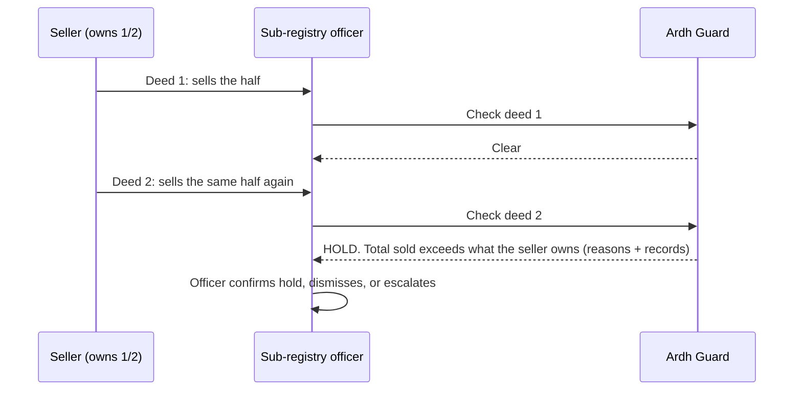
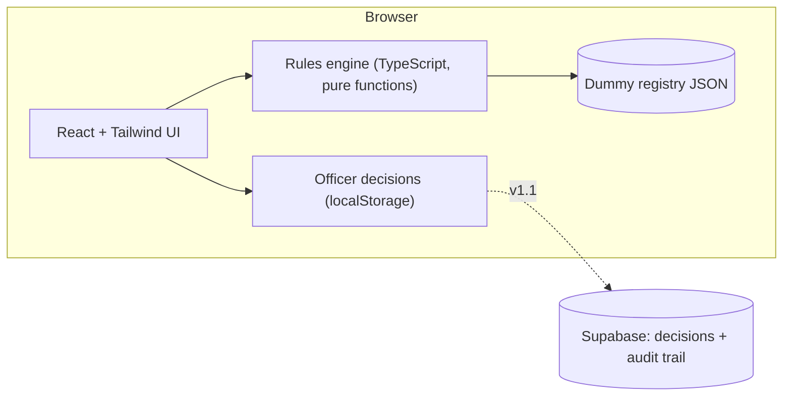

<p align="center"></p>

<p align="center">
  <b>Explainable conflict checks for land deeds, before registration and before mutation.</b><br>
  LandTech Innovation Hackathon 2026 · Track: Digital Land Records, Verification &amp; Digitization · Problem <b>P3, Catch Fraud &amp; Double-Selling</b>
</p>

<p align="center">
  <a href="https://land-tech-innovation-hackathon-2026.vercel.app/"></a>
  
  
</p>

<p align="center"><a href="https://land-tech-innovation-hackathon-2026.vercel.app/"></a></p>

<p align="center"><sub>Click the demo to try it live. Six one-click examples on the first screen.</sub></p>

---

## The problem

In Bangladesh, a deed, the khatian chain (CS, SA, RS, BS) and the mutation record are kept by different offices. Nobody cross-checks them before a sale or a mutation is accepted. A khatian alone is not conclusive proof of ownership, so the same land can be sold twice and sellers who do not own the land can slip through.

## What Ardh Guard does

A second pair of eyes at **two moments**: before a deed is registered, and before a mutation is approved. It compares the paperwork with the record chain and the seller's earlier deeds, then flags the case for a human officer **with plain-language reasons**. It never decides ownership.

<p align="center"></p>

The classic double sale, as Ardh Guard sees it:



## See it

| | |
|---|---|
| **Check a deed**<br>Enter a deed, get hold, review or clear with reasons.<br> | **Alerts for officers**<br>Filter by checkpoint and severity, then decide.<br> |
| **Parcels**<br>The CS, SA, RS, BS chain with deeds and mutations.<br> | **Benchmark**<br>Which planted anomalies the rules caught, with caveats.<br> |
| **How it works**<br>The flow, the two checkpoints and all eight checks.<br> | **Roadmap and limits**<br>What is built, what is next, what it cannot do.<br> |

<p align="center"><br><sub>Works on a phone too.</sub></p>

## The eight checks

| Check | Raised | Catches |
|---|---|---|
| Land sold more than once | Hold | Same seller's total sales exceed what they own (double sale) |
| Selling more than the seller owns | Hold | Deed claims more than the seller's recorded share |
| Government (khas) land | Hold | Latest record shows the plot as khas or government land |
| Seller is not on the record | Hold | Seller absent from the latest khatian |
| Document looks altered | Hold | QR code or signature does not match |
| Mutation does not match the deed | Review | Mutation changed a different area than the deed transfers |
| Deed never mutated | Review | Registered long ago, record still shows the old owner |
| Mutation resubmitted after rejection | Note | A workflow signal for human review |

## Benchmark (dummy data)

On the seed registry the rules caught **8 of 8 testable planted anomalies** and flagged **8 of 25 deeds**, none outside the planted cases. Run it yourself with `npm run eval`.

> **Read this before quoting the numbers.** The data is small and made up, and the rules were written knowing how it was generated. This is a regression test that the rules do what we designed, **not** a measure of accuracy on real records. The ninth anomaly (a chain break between surveys) is not testable on this seed. See [`data/DATA_README.md`](data/DATA_README.md).

## How it is built



- **No backend needed.** The engine runs in the browser on the dummy data, so the demo works offline and on any phone.
- **Pure functions.** `analyze(registry)` takes records in and returns alerts out. It is easy to test (`npm test`) and easy to explain.
- **Hosted on Vercel**, deployed from this repository.

**Stack:** TypeScript · React 19 · Vite · Tailwind CSS 4 · Vercel (Supabase planned for decisions and audit)

## Run it locally

```bash
git clone <this repo>
cd <repo>
npm install
npm run dev        # web app on http://localhost:5173
npm run build      # typecheck + production build
npm run eval       # benchmark in the terminal (Node 22.18 or newer)
npm test           # 12 engine checks: 6 live scenarios + 6 planted anomalies
```

<details>
<summary>Repository map</summary>

```
src/engine/      rules, types, benchmark evaluation (no dependencies)
src/pages/       Check, Inbox (alerts), Cases (parcels), Benchmark, HowItWorks, About
src/components/  chain strip and UI pieces
src/lib/         dummy data access, officer decisions store
data/            dummy registry (JSON/CSV), generator script, labelled anomalies, notes
docs/            plan, research notes, source triage, concept note outline, media
scripts/         evaluate.ts, test-rules.ts, make-media.py (README screenshots)
supabase/archive/ earlier prototype schema, kept for v1.1 (audit chain)
```
</details>

## Data used

**Dummy data only.** A fictional registry (3 mouzas, 24 parcels, 96 khatians, 25 deeds, 23 mutation cases, 9 labelled anomalies) generated by [`data/gen_seed.py`](data/gen_seed.py). No real people, NID numbers, phone numbers or land records, and nothing is scraped from government websites. No external dataset is used; if a public, non-personal source is added later it will be credited here.

## AI tools used

- **Claude (Anthropic):** project planning, drafting the rules engine, UI code and documentation. The team reviewed everything and can explain every file.
- **Consensus.app:** literature search reports, summarised in [`docs/SOURCES.md`](docs/SOURCES.md).
- No AI model runs inside the app and none was trained.
- _TODO: add any other tools you used._

## Roadmap

| | Scope | Status |
|---|---|---|
| **v1 (Round 1)** | Rules engine, check a deed, alerts with officer decisions, parcel pages, benchmark, in-app docs | Built |
| **v1.1 (final round)** | Coherent-chain seed and chain-break rule · owner alert and dispute hold · saved decisions with audit trail (Supabase) · Bangla name matching · a "messy but innocent" benchmark slice | Next |
| **v2** | Plot lineage across surveys (splits, merges, renumbering) · pilot with one sub-registry and AC Land office under a formal agreement · ML ranking after the rules · scan intake for old khatians (P1) | Later |

**Changes since Round 1:** _TODO: list them here before the final._

## Limitations

- All data is made up. A real pilot needs an agreement with the land authorities.
- The benchmark is small and the rules were written knowing the planted anomalies.
- Chain-break detection is untested: the seed has no coherent ownership chains.
- Names are matched exactly; Bangla spelling variants are not handled.
- Each parcel arrives with a lineage id. Linking plots across surveys is the hard part in reality.
- Ardh Guard flags cases for officers. It does not decide ownership and is not a legal title check.

More in [`docs/`](docs): [plan](docs/PLAN.md) · [research notes](docs/RESEARCH_NOTES.md) · [sources](docs/SOURCES.md) · [concept note outline](docs/CONCEPT_NOTE_OUTLINE.md)

## Team Ardh

| | |
|---|---|
| **Jobayer** (Team Leader) | [@MJZ-Hossen](https://github.com/MJZ-Hossen) |
| **S.M. Mehedy Kawser** | [@mehedyk](https://github.com/mehedyk) |
| Faculty mentor | Zannatul Mawa Koli |
| Industry mentor | MD. Tahamid Hassan Sadib (CSE-TECH) |

Built for the LandTech Innovation Hackathon 2026, organized by the Department of CSE and CSE-TECH, Daffodil International University, with support from the Department of Law.

## License

_TODO: choose a license (the organizers encourage open source, for example MIT)._
