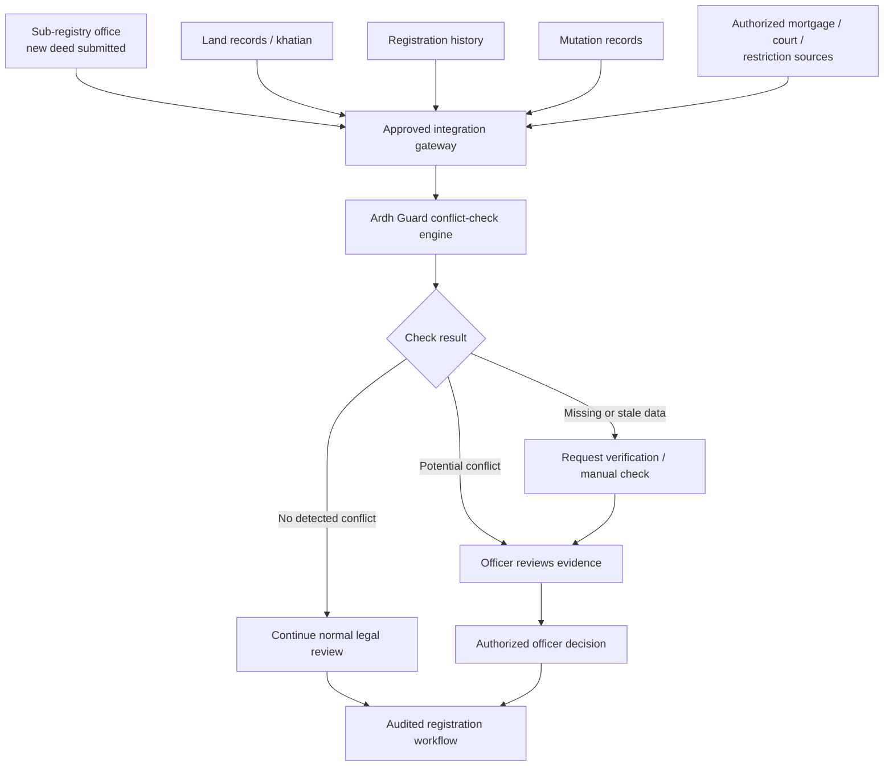

# Integration plan: adding Ardh Guard to the land-administration system

**Status.** This is a design for a pilot, not something the prototype does today. The prototype runs on dummy data in the browser, with no connection to any government system. The hackathon rule book allows dummy data only and forbids scraping or bulk-downloading government websites [1], so nothing here has been tested against a real system. Every named source below is a **candidate to confirm with its owner**, not a claim that an interface exists.

**One line.** Ardh Guard is a read-only advisory layer next to the registration and mutation workflow. It reads records through an approved gateway, runs the checks, and gives an authorized officer a result with reasons. A person decides. Every path is logged.

---

## 1. Where it sits



The case for a checkpoint like this is already made in the literature: records, registration and management of land run through separate authorities [4], and reform work asks for inter-checking between registering officers and AC (Land) offices before registration [3]. Government has also moved registration and mutation closer: a joint Land and Law ministry service with a2i processes mutation digitally within eight days of registration, approved by cabinet on 9 November 2020 and launched in about 17 upazilas [21]. Ardh Guard is meant to sit **before** those steps complete, so a conflict is caught while it can still be held.

## 2. Principles

1. **Read-only.** It never writes to land records and cannot register, reject or mutate anything.
2. **A person decides.** The only route to a decision is an authorized officer. Ardh Guard never decides ownership.
3. **Approved gateway only.** Data arrives only through connections the owning office has agreed to in writing. Each source can be switched off on its own.
4. **Missing data never reads as clear.** If a source is absent, late or stale, the result is "missing or stale data" and goes to manual verification. A timeout is never a pass.
5. **Every path is audited.** Clear results are logged too, not only holds.
6. **Collect the least.** Fetch only the fields a check needs, keep them only as long as needed, and show citizens only their own check.
7. **Rules are versioned.** A result says which rule set produced it, so a decision can be re-examined later.

## 3. Three ways to connect

| Mode | What it is | When |
|---|---|---|
| **A. Shadow** | Runs beside one sub-registry and its AC Land office. Officers see alerts, the workflow is unchanged, nothing blocks. We measure false alarms and misses. | Pilot, first |
| **B. Checkpoint** | The registration and mutation systems call Ardh Guard at the two checkpoints and show the result to the officer. A hold is advisory until the owner of the workflow decides it can gate. | After shadow mode meets its exit criteria |
| **C. Citizen check** | A public "check before you buy" page with limited, privacy-safe output. | Last, and only after a legal review |

## 4. Interface sketch (to agree with the owning offices)

The engine already works this way inside the app: `analyze(registry)` takes records in and returns alerts, so a gateway only has to produce a `Registry`-shaped input. The same contract as a service:

```http
POST /v1/checks
{ "checkpoint": "pre-registration" | "pre-mutation",
  "parcel_ref": "…",                       // lineage id, mouza + plot, or an office's own reference
  "deed": { "seller": "…", "buyer": "…", "area_sold_dec": 12.5, "share_sold": "1/2",
            "qr_valid": true, "signature_consistent": true, "registration_date": "…" } }

200 OK
{ "report_id": "ARDH-1A2B3C4D",
  "result": "clear" | "potential_conflict" | "insufficient_data",
  "alerts": [ { "rule": "OVERLAPPING_SALE", "severity": "block" | "review" | "info",
                "reason": { "bn": "…", "en": "…" }, "evidence": ["D0002"] } ],
  "sources": [ { "name": "land_records", "as_of": "…", "status": "fresh" | "stale" | "unavailable" } ],
  "rules_version": "…", "records_as_of": "…" }

POST /v1/decisions      // officer's hold / dismiss / escalate, signed in as the officer
GET  /v1/reports/{id}   // the stored report, for audit
```

Notes: requests carry an idempotency key; reasons come in both languages; `insufficient_data` is a first-class result, and the prototype has only a partial form of it today (the "deed never mutated" check). The report ID in the prototype is a short reference for one check, not a certificate.

## 5. Data sources

Owners are **candidates to confirm**. "In prototype" is the matching type in `src/engine/types.ts`.

| Source | Candidate owner | Fields needed | In prototype | Notes |
|---|---|---|---|---|
| New deed | Sub-registry office | Seller, buyer, area and share sold, plot reference, QR and signature validity, date | `Deed` | Raised at the pre-registration checkpoint |
| Land records (khatian chain CS, SA, RS, BS) | Land administration (records and survey offices) | Owners and shares, plot, area, land class (khas), survey year | `Khatian`, `Lineage` | Linking plots across surveys is the hard part [2] |
| Registration history | Registration authority | Earlier deeds by the same seller on the same plot | `Deed` list | Drives the double-sale and over-sale checks |
| Mutation records | Land administration, AC Land offices | Case, status, area mutated, dates | `Mutation` | The registration-to-mutation link is being automated [21] |
| Mortgage, court orders, restrictions | Banks / courts / registration, each to confirm | Existence of a lien, injunction or restriction on the plot | not built | Needed for the portal design's seven mandatory checks; v2 |
| Vested and abandoned property lists | Land administration, district level, to confirm | Plot ids on the list | not built | Officer-side check, v2 |
| Land development tax status | Land administration, to confirm | Paid-up-to year for the holding | not built | v1.1 to v2 |
| Published mouza rates | Registration authority (published schedule) | Rate per land class and mouza | not built | Public, non-personal; the safest first addition |
| Mouza maps | Survey and records authority, to confirm | Plot geometry | not built | Needed for the map overlay |
| Identity (NID) | Election Commission | Yes/no match of a name against an NID, nothing stored | not built | See section 7; only with a legal basis and consent, and last |

## 6. Gateway requirements

- **Authentication and authorization.** Mutually authenticated connections, per-source scopes and allow-lists; officers sign in through the organization's own identity system; roles are citizen, officer, AC Land officer, administrator and auditor.
- **Freshness.** Each source reports an `as_of` time. A per-source maximum age decides when data counts as stale. Stale, late or failed means `insufficient_data`.
- **Minimization.** Hash party identifiers where a name is not needed, never store NID numbers, and strip fields the checks do not use.
- **Caching.** Short, per-source time-to-live, so a conflict that appears today is not hidden by yesterday's copy.
- **Audit log.** Append-only and hash-chained, with who asked, which sources, which rule set, what result, and what the officer did. The earlier tested design is in `supabase/archive/` and a draft schema in `supabase/migrations/`.
- **Operations.** Timeouts and retries that fail toward manual verification; monitoring of source freshness and latency; a documented way to turn a source or the whole service off without affecting registration.
- **Hosting and residency.** Inside Bangladesh unless the owning agency and the data protection law allow otherwise (see section 7).

## 7. Legal, privacy and security

- **Data protection.** The Personal Data Protection Ordinance 2025 is described as requiring informed consent, purpose limitation, prompt breach notification, equivalent protection for cross-border transfers, and heightened security for sensitive data (which includes legal affairs and geo-location), under a National Data Governance Authority, with penalties of up to seven years in prison and a fine of up to BDT 20,00,000 [22]. Land and deed records are not named in that article, but they reveal legal matters and location, so assume they are covered. At the time of that article the draft awaited gazette and some sections would take effect 18 months later; later headlines report a gazette we did not open. **Check the current legal status and obligations with a lawyer before any pilot.**
- **NID access is tightly controlled.** In July 2023 the Election Commission put 171 partner organisations under round-the-clock surveillance, made an ICT Division security certificate a condition for a data agreement, and planned audits every three to six months [23]. Plan for that bar, and use NID verification only if the checks truly need it.
- **Biometrics are out of scope.** The mockups show a live fingerprint match. We do not plan it.
- **Ownership.** Ardh Guard is not a legal title check and does not decide ownership. Outputs and reports say so.
- **Official identity and authority.** An official seal, a digital notice or stay, government branding or a helpline link all need formal authority and a digital-signature framework. Until then the app presents itself as a prototype and the report ID is only a reference.

## 8. What the portal mockups showed, and what each needs

The design mockups in `design/potential-designs/` show more than the prototype has data for. Nothing below was invented in the app; each needs a source or an authority first.

| Mockup element | Status | What it needs | Phase |
|---|---|---|---|
| Seven mandatory checks (double sale, khas, vested property, court case, bank mortgage, heirship, land tax) | Two covered (double sale, khas); five not | Sources in section 5 | v1.1 to v2 |
| "Missing or stale data" outcome | Partial | Per-source freshness and the `insufficient_data` result | v1.1 |
| Price against the published mouza rate | Not built | Published rate table; a price field in the data | v1.1 |
| Division, district, upazila, mouza filters; deed-number search | Not built | Can be built on dummy data now | v1.1 |
| Text-size and high-contrast controls; installable offline mode | Not built | None; can be built now | v1.1 |
| Cadastral map and RS vs BS overlay | **Sketch built** on made-up outlines (`data/parcel_geometry.json`); real geometry not available | Plot geometry from the survey authority | v2 |
| NID check, party photos | **Locked placeholder** in the officer view (a collapsible box saying why it is off); photos not kept | Legal basis, consent, EC agreement [23] | v2, only if justified |
| Live fingerprint match | **Simulated demo only**: a button shows a made-up stored result, no sensor, advisory, not in reports | Out of scope for real use; biometrics are sensitive data [22] | none |
| Officer and citizen on one screen | **Built** (Both view, side by side) | None | done |
| Digital notice or stay, official seal and QR certificate | Not built | Formal authority and a signature framework | after v2 |
| Government header, emblem, helpline | Not used | Authorization to use them | after v2 |

## 9. Rollout and exit criteria

| Stage | Scope | Exit criteria |
|---|---|---|
| 0. Prototype | Dummy data, rules engine, officer and citizen views, downloadable reports | Done |
| 1. Agreement | A written agreement with one sub-registry and its AC Land office: purpose, fields, retention, security review, a named owner on each side | Signed; legal review done |
| 2. Shadow mode | Read-only feed; alerts shown to officers; workflow unchanged | Officers can explain each alert; false-alarm rate and miss rate measured on real cases with an agreed target; data freshness met for the agreed share of checks |
| 3. Checkpoint | Results shown inside the registration and mutation steps; decisions recorded; sign-in and roles live | Audit log verified by an independent reviewer; officer time per case not worse than before |
| 4. Scale | More offices; mortgage, court, vested-property and land-tax sources; citizen page | Per-office review of the same criteria |

## 10. Risks

| Risk | Response |
|---|---|
| A source is down or stale and the system reads that as clear | `insufficient_data` is a result; timeouts route to manual verification |
| False alarms slow honest transactions | Shadow mode first; "messy but innocent" benchmark slice; every alert carries its reason and evidence |
| Officers over-trust or under-trust alerts | Advisory only; reasons in plain language; decisions logged and reviewable |
| Privacy breach | Minimization, residency, breach process, audits [22][23] |
| Rule changes alter past results | Rules versioned; reports store the version |
| Looks official when it is not | Prototype labelling; report ID is a reference only; no government branding without authority |

## 11. Questions for the owning offices

- Who owns each source, and what interface or export exists today?
- How fresh is each source, and how do offices know?
- Which identifier ties a deed to a khatian and plot, and how are splits and merges recorded?
- Can mortgages, court orders and vested-property flags be queried by plot?
- What approvals, security certificates and audits does the pilot need?
- Which law and which agency govern sharing deed and khatian data for this purpose?

<!-- refs:start -->
## References

[1] LandTech Innovation Hackathon 2026 Rule Book, version 1.2. Department of CSE and CSE-TECH, Daffodil International University. [LandTech Innovation Hackathon 2026 Rule Book (v1.2)](https://landtech.diu.edu.bd/landtech)  
[2] Raziv, M. M. H., Jalil, M. A., Mia, M. T. and Mahmud, F. U. (2024). Journal of Asian and African Social Science and Humanities, 10(2), 31-44. [Errors in the Land Record of Rights (Khatiyan) and the Remedial Procedure in Bangladesh: An Analysis of Existing Regulatory Framework and Future Reforms](https://doi.org/10.55327/jaash.v10i2.335)  
[3] Ayatullah, M. (2024). Feni University Journal, 3(1), 211-222. [Essentiality of Reforms of the Registration Act 1908: E-Registration Perspective](https://doi.org/10.3329/fuj.v3i1.86557)  
[4] Emam, J. (2022). Bangladesh Journal of Public Administration, 30(2), 47-62. [The Prospect of Integrated Land Administration and Management System (ILAMS) for Improving Land Related Service Delivery in Bangladesh](https://doi.org/10.36609/bjpa.v30i2.360)  
[21] The Business Standard (2020). Coordinated land registration, mutation to benefit over 1 crore people: Land secretary. [Coordinated land registration, mutation to benefit over 1 crore people: Land secretary](https://www.tbsnews.net/bangladesh/coordinated-land-registration-mutation-benefit-over-1-crore-people-land-secretary-156184)  
[22] The Daily Star (2025). Bangladesh's Personal Data Protection Ordinance 2025: key takeaways. [Bangladesh's Personal Data Protection Ordinance 2025: key takeaways](https://www.thedailystar.net/tech-startup/news/bangladeshs-personal-data-protection-ordinance-2025-key-takeaways-4015401)  
[23] The Business Standard (2023). EC to monitor partner organisations to protect NID data. [EC to monitor partner organisations to protect NID data](https://www.tbsnews.net/node/664882)  

### Other project references

- [5] [Citizens' Perspective on Land E-Mutation at Upazila Land Offices in Mymensingh](https://doi.org/10.34104/ajssls.023.02910305)
- [6] [A Blockchain-based Land Title Management System for Bangladesh](https://doi.org/10.1016/j.jksuci.2020.10.011)
- [7] [Digitizing Land Governance in Bangladesh: A Qualitative Study of Urban and Rural Citizens' Experiences with the Digital Land Record Management System](https://doi.org/10.36481/jsp.v01.i01.3vmg5j09)
- [8] [The Impact of E-services on People's Empowerment: An Investigation into E-mutation Service of Bangladesh](https://doi.org/10.53808/KUS.2024.21.02.1177-ss)
- [9] [Digitalization of the Land Record System in Bangladesh: Prospects and Challenges](https://ssrn.com/abstract=5012153)
- [10] [Digitising land records seen as a paradigm shift](https://observerbd.com/news/555055)
- [11] [Consensus: AI research assistant](https://consensus.app)
- [12] [Claude (Anthropic)](https://www.anthropic.com/claude)
- [13] [React](https://react.dev)
- [14] [Vite](https://vite.dev)
- [15] [Tailwind CSS](https://tailwindcss.com)
- [16] [Vercel](https://vercel.com)
- [17] [Supabase](https://supabase.com)
- [18] [Hugging Face](https://huggingface.co)
- [19] [Ardh Guard: live prototype](https://land-tech-innovation-hackathon-2026.vercel.app/)
- [20] [Ardh Guard: pitch deck](https://land-tech-innovation-hackathon-2026.vercel.app/deck/)

Numbers are the same in every file. Full list with notes on what we read: [`docs/REFERENCES.md`](REFERENCES.md).
<!-- refs:end -->
